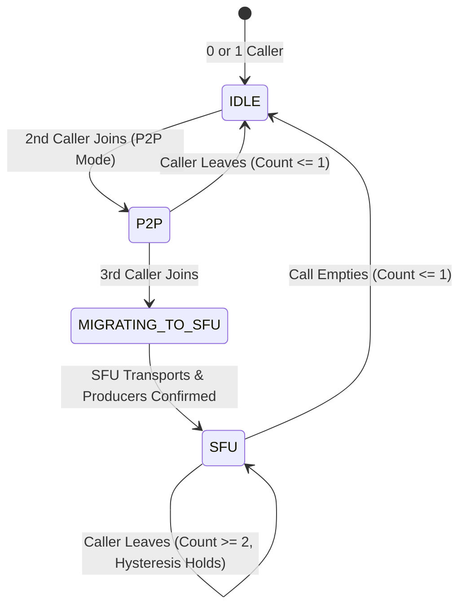
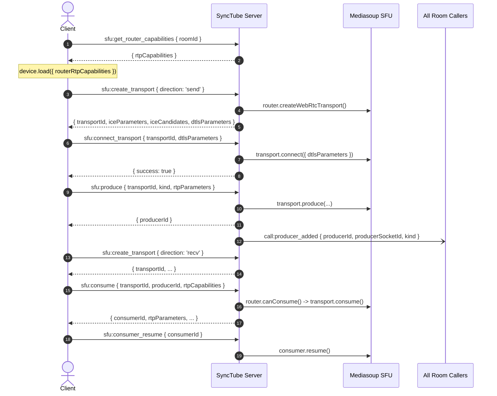

# SyncTube Hybrid WebRTC P2P + Mediasoup SFU Architecture

## 1. Overview and Core Objectives

SyncTube's media communication system integrates an **adaptive hybrid calling architecture** directly into synchronized watch-party rooms:

- **1-to-1 Calls (Active call members = 2)**: Direct peer-to-peer (P2P) WebRTC connection. Minimizes media server load and bandwidth costs while offering minimum latency.
- **Group Calls (Active call members >= 3)**: Mediasoup Selective Forwarding Unit (SFU). Each participant sends audio/video to the SFU once, and the SFU selectively forwards streams to all authorized receivers. Full-mesh P2P is strictly prohibited for group calls to eliminate $O(N^2)$ client CPU/upload bottlenecks.
- **Seamless Coordinated Migration**: When a 3rd participant joins an active 1-to-1 P2P call, the system coordinates an atomic transition to the Mediasoup SFU.
- **Hysteresis & Anti-Flapping**: When a group call drops back from 3 to 2 participants, the call remains on the SFU until teardown to prevent rapid toggling between architectures.

```
       ┌────────────────────────────────────────────────────────┐
       │             SyncTube Watch-Party Room                  │
       │  (Chat, Synced Video, Playlist, Polls, Reactions)      │
       └──────────────────────────┬─────────────────────────────┘
                                  │ Active Call Membership
                  ┌───────────────┴───────────────┐
                  ▼                               ▼
         Active Callers == 2              Active Callers >= 3
       ┌──────────────────────┐         ┌──────────────────────┐
       │   WebRTC Direct P2P  │         │    Mediasoup SFU     │
       │ (STUN/TURN Fallback) │         │ (Selective Forward)  │
       └──────────────────────┘         └──────────────────────┘
                  ▲                               │
                  │   3rd Participant Joins       │
                  └──────── Migration ────────────┘
```

---

## 2. Traffic Flow Separation

SyncTube maintains a strict separation of three independent traffic streams:

| Traffic Stream | Transport Protocol | Path | Payload Description |
| :--- | :--- | :--- | :--- |
| **Signaling & Watch Party** | Socket.IO (WebSocket / HTTP Long-Polling) | Browser <-> Express Backend | Room chat, playback sync (`sync_state`), polls, reactions, and WebRTC / SFU signaling metadata. **Zero audio/video media bytes.** |
| **P2P Voice / Video** | WebRTC SRTP / SRTCP (Direct UDP, optional TURN relay) | Browser <-> Browser | Direct peer-to-peer media encrypted with DTLS-SRTP for 1-to-1 calls. |
| **SFU Voice / Video** | WebRTC SRTP / SRTCP (UDP / TCP fallback) | Browser <-> Mediasoup Worker | Media producers sent to SFU; consumers forwarded by SFU to receivers. |

---

## 3. Server-Side Topology Policy & State Machine

Decisions are governed strictly by the server's `CallTopologyPolicyManager`, evaluating **active media call members** (users who have explicitly clicked *Join Call*), not passive watch-party room viewers.

### State Transitions



1. **`IDLE` (0 or 1 Caller)**:
   - No P2P peer connection or SFU router is allocated.
2. **`P2P` (Exactly 2 Callers)**:
   - Server allocates a versioned P2P topology session.
   - Validates signaling targets (`webrtc:p2p:offer`, `webrtc:p2p:answer`, `webrtc:p2p:ice_candidate`) ensuring both parties are current members of the active call in the same room.
3. **`MIGRATING_TO_SFU` (Transition Triggered)**:
   - Triggered when a 3rd caller joins.
   - Server emits `call:topology_transition` with `{ mode: 'sfu', version, previousMode: 'p2p' }`.
   - Mediasoup router and transports are initialized for the room.
   - P2P connections are marked as migrating and remain active until clients confirm SFU subscriptions (`call:sfu_ready`), preventing sudden audio/video drops.
   - P2P connections are then cleanly closed.
4. **`SFU` (3+ Callers or Hysteresis Hold at 2)**:
   - All media routing is handled by the room's dedicated Mediasoup router.
   - If a caller leaves and the count drops to 2, the call **remains in SFU mode** to prevent media interruption and rapid oscillation.
   - When call drops to 0 or 1 caller, the SFU router, transports, and producers are cleanly disposed of.

---

## 4. Mediasoup SFU Lifecycle & Media Module

The media subsystem is organized under `server/src/media/`:

- **`workerPool.ts`**: Manages a pool of Mediasoup C++ native workers according to CPU core count or `MEDIASOUP_NUM_WORKERS`. Implements least-loaded worker selection, worker death restart, and graceful shutdown.
- **`callMediaRouter.ts`**: Manages per-call Mediasoup `Router`, `WebRtcTransport` (send & receive per client), `Producer` (audio & video per client), and `Consumer` entities.
- **`mediasoupManager.ts`**: Facade coordinating room routers, transport lifecycle, ownership verification, and participant cleanup.

### Standard Mediasoup Client Workflow



---

## 5. Security & Isolation Controls

1. **Input Validation**: Every incoming signaling payload is strictly validated using Zod schemas (`server/src/socket/schemas.ts`).
2. **Room-Scoped Isolation**:
   - WebRTC P2P signaling validates that the target socket is an active caller in the *same* room. Cross-room signaling is rejected.
   - SFU subscriptions verify that the requested `producerId` belongs to an active caller in the sender's room. Cross-room producer consumption is strictly impossible.
3. **Self-Consumption Protection**: A participant cannot consume their own audio or video producers.
4. **Ownership Enforcement**: Clients can only connect, produce, or close transports and producers that they personally own on the server.
5. **No Secret Leakage**: STUN/TURN passwords and Mediasoup internal listening addresses are not exposed in client broadcasts or error traces.

---

## 6. Adaptive Video Quality, Simulcast & Telemetry

### Simulcast
Video producers use 3 spatial/temporal encoding layers when browser/codec support is available:
- **Layer 0 (r0)**: 320x180, 150 kbps (thumbnail / gallery tile).
- **Layer 1 (r1)**: 640x360, 500 kbps (standard tile).
- **Layer 2 (r2)**: 1280x720, 1500 kbps (spotlight / pinned tile).

### Pinning & Spotlight Layout
When a user pins a remote participant:
- The client sends `sfu:consumer_preferred_layers` setting `{ spatialLayer: 2, temporalLayer: 2 }` for the pinned feed.
- Other consumers are requested with `{ spatialLayer: 0, temporalLayer: 1 }` or `{ spatialLayer: 1, temporalLayer: 2 }`.
- Mediasoup forwards only the requested layers, minimizing downstream bandwidth.

### Network Quality Telemetry
A throttled client stats engine polls `getStats()` every 3 seconds to measure:
- Round-trip time (RTT), jitter, and packet loss percentage.
- Available outgoing bitrate and frames dropped.
- Categorized with hysteresis into:
  - **Good**: Packet loss < 2%, RTT < 150ms.
  - **Unstable**: Packet loss 2%-8% or RTT 150ms-350ms.
  - **Poor**: Packet loss > 8% or RTT > 350ms.

---

## 7. Environment Configuration & Deployment Requirements

| Environment Variable | Default | Purpose |
| :--- | :--- | :--- |
| `CALL_TOPOLOGY_MODE` | `hybrid` | Options: `hybrid` (P2P for 2, SFU for 3+), `sfu_only`, `p2p_only`, `disabled`. |
| `MEDIASOUP_LISTEN_IP` | `0.0.0.0` | IP address on which Mediasoup workers listen for UDP/TCP traffic. |
| `MEDIASOUP_ANNOUNCED_IP` | `127.0.0.1` | Publicly reachable IP address sent in ICE candidates to clients. |
| `MEDIASOUP_MIN_PORT` | `40000` | Minimum UDP port for WebRTC media transports. |
| `MEDIASOUP_MAX_PORT` | `40200` | Maximum UDP port for WebRTC media transports. |
| `MEDIASOUP_NUM_WORKERS` | `0` (CPU cores) | Number of worker processes to spawn. |
| `TURN_URLS` | `""` | Comma-separated TURN server URLs for restrictive NAT traversal. |
| `TURN_USERNAME` | `""` | TURN authentication username. |
| `TURN_CREDENTIAL` | `""` | TURN authentication credential/secret. |

### Deployment Considerations
- **Process Architecture**: Mediasoup runs native C++ worker child processes. It requires a long-running Linux/Unix container or VM (e.g. Docker, AWS EC2, DigitalOcean, Fly.io with UDP ports open).
- **Firewall & NAT**: Ports in range `MEDIASOUP_MIN_PORT` through `MEDIASOUP_MAX_PORT` must be forwarded and open for UDP.
- **Serverless Incompatibility**: Mediasoup **cannot** run in serverless platforms (such as Vercel Serverless Functions or AWS Lambda) because it requires persistent worker processes and open UDP sockets.
- **Multi-Instance Scaling**: Single-instance deployment supports full room-level media routing. Multi-instance SFU clustering requires pipe transports between instances; in this release, room media is routed on the instance hosting the room.
